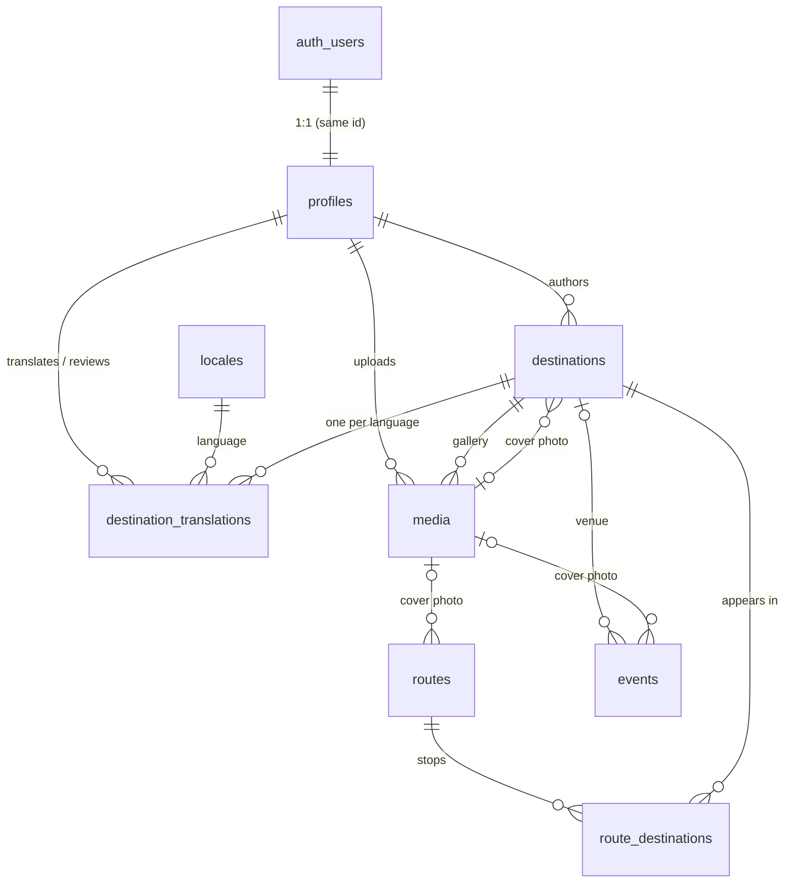

# FengYou database (Supabase / PostgreSQL)

## Files

| File | What it does |
| --- | --- |
| `migrations/20261114120000_initial_schema.sql` | Types, tables, keys, indexes, triggers |
| `migrations/20261114120100_row_level_security.sql` | Who may read/write which rows (RLS) |
| `migrations/20261114120200_storage.sql` | The `media` file bucket and its upload rules |
| `migrations/20261114130000_stories_and_itineraries.sql` | Student stories (with editor review) and personal itineraries |
| `config.toml`, `templates/` | Local Supabase settings and the sign-in code email |
| `tests/rls.test.mjs` | Acts as each role and checks the rules (`npm run test:db`) |
| `seed.sql` | Local-only sample data: 4 published destinations with map coordinates |

Migrations run in filename order. Never edit one that has already been applied
to a shared database. Add a new migration instead.

## Relationships



- **profiles ↔ auth.users (one-to-one).** Supabase Auth owns logins; `profiles`
  adds app data (name, role). Same `id`; a trigger creates the profile on signup.
- **destinations → destination_translations (one-to-many).** Facts that don't
  change with language (coordinates, category, status) live once in
  `destinations`. Words live in one row per language, keyed by
  `(destination_id, locale)`. Each language row is reviewed separately.
- **destinations ↔ routes (many-to-many) through route_destinations.** A route
  has many stops, and a destination can be in many routes. The junction table
  also stores data about the link itself: `position` (stop order) and
  `suggested_minutes`.
- **media.** A destination has many photos (`media.destination_id`), and
  destinations, routes and events can each point to one cover photo
  (`cover_media_id`).
- **events → destinations (optional many-to-one).** An event can happen at a
  known destination, or at a free-text `venue`.

## What happens on delete

| When you delete… | Effect | Why |
| --- | --- | --- |
| an auth user | their profile is deleted; their content stays with `author_id = null` | keep the content when a student leaves |
| a destination | its translations and gallery media are deleted | they're meaningless alone |
| a destination still used by a route | **refused** | don't silently break a published route |
| a route | its stops are deleted | — |
| a media row | covers pointing to it become `null` | the page shows no cover; nothing breaks |

## Roles and access

| | anon | visitor | contributor (student) | editor (teacher) | admin |
| --- | --- | --- | --- | --- | --- |
| Read published content | ✓ | ✓ | ✓ | ✓ | ✓ |
| Read own profile | | ✓ | ✓ | ✓ | ✓ |
| Draft destinations, translations, media | | | own only | ✓ | ✓ |
| Publish, review translations | | | | ✓ | ✓ |
| Manage routes and events | | | | ✓ | ✓ |
| Change user roles | | | | | ✓ (`set_user_role`) |

## Keys: which goes where

- `NEXT_PUBLIC_SUPABASE_PUBLISHABLE_KEY` (anon) can go in the browser. RLS
  limits what it can do.
- `SUPABASE_SECRET_KEY` (service role) **bypasses RLS**. Use it only in server
  code, never with a `NEXT_PUBLIC_` prefix, and never in a `"use client"` file.
  See `.env.example`.

## Running it locally

Requires Docker Desktop to be running. From the `fengyou` folder:

```bash
npx supabase start
```

The first start downloads the Supabase images (several GB). When it finishes
it prints an **API URL** and a **publishable key**. Put them in
`fengyou/.env.local`:

```
NEXT_PUBLIC_SUPABASE_URL=http://127.0.0.1:54321
NEXT_PUBLIC_SUPABASE_PUBLISHABLE_KEY=sb_publishable_...
```

Restart `npm run dev`. Sign-in emails don't really get sent locally; open the
mail viewer at http://127.0.0.1:54324 to read the 6-digit code.

## Giving someone a role

New accounts are `visitor`s (they can keep an itinerary). To let a student
share stories or a teacher review them, an admin runs the following in the
Supabase SQL editor (Studio at http://127.0.0.1:54323 locally). The very
first admin has to be created this way too:

```sql
update public.profiles set role = 'contributor'   -- or 'editor' / 'admin'
where id = (select id from auth.users where email = 'student@example.com');
```

After that, admins can use `select public.set_user_role('<user id>', 'editor');`.

## Applying the migrations

With the [Supabase CLI](https://supabase.com/docs/guides/cli):

```bash
supabase link --project-ref <your-project-ref>
supabase db push
```

To try it locally first (requires Docker), run `supabase start` and then `supabase db reset`.
